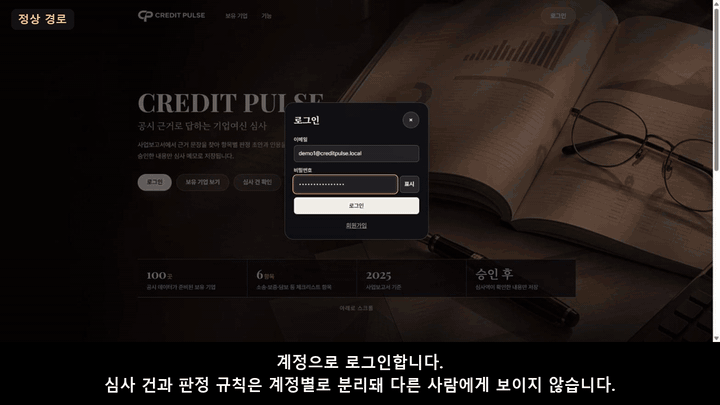
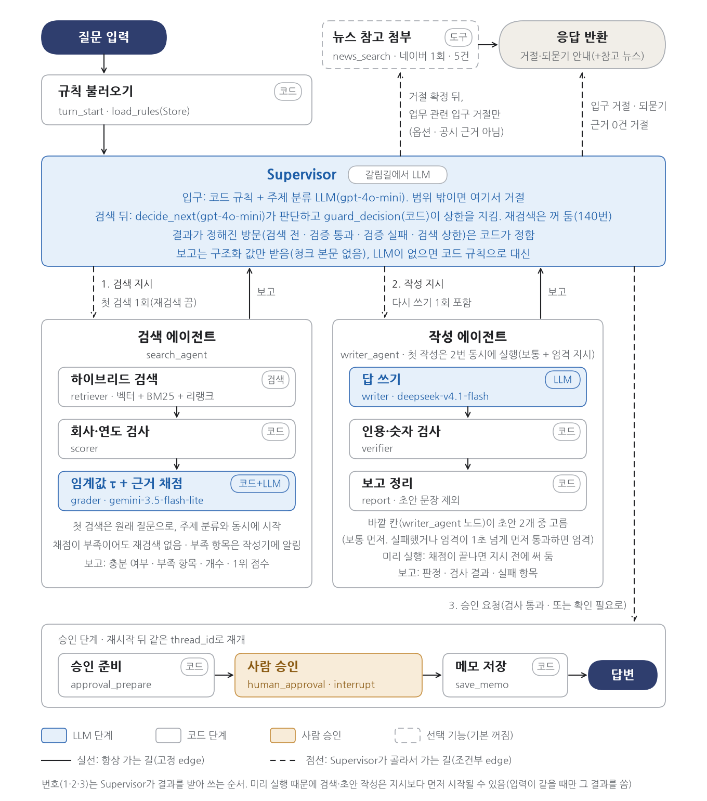
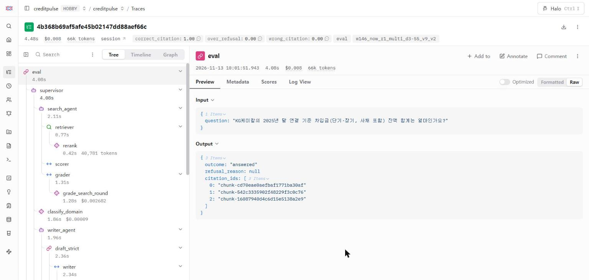

# CreditPulse

기업여신 심사역이 차주 기업의 DART 사업보고서에서 체크리스트 항목(소송, 보증·담보, 고객 집중도, 차입금 등)의 근거를 찾아 **판정 초안**을 받고, **사람이 승인한 것만** 심사 메모로 저장하는 에이전트형 RAG 서비스입니다.
근거 청크를 인용해 답하고, 공시에 없는 항목은 사유 코드와 함께 거절하며, 승인 단계에서 그래프가 멈춥니다(LangGraph `interrupt`).

| 항목 | 내용 |
|---|---|
| 상태 | 수료 과정 팀 프로젝트, 개발 종료(제출 마감 2026-11-17) |
| 출처 | AI Human 7기 3조 팀 프로젝트의 **공개용 사본**. 원본은 비공개 저장소 `aihuman-7th/proj3-a`(기준 커밋 `372ac28`, 2026-11-18). 커밋 이력은 가져오지 않았고 팀원 동의를 받았습니다 |
| 팀 | 박민영(팀장, 배포·운영·문제와 시장 근거), 류승민(검색·데이터), 서정현(LangGraph 에이전트). 서정현의 담당 범위와 기여는 [CONTRIBUTIONS.md](CONTRIBUTIONS.md) |
| 기술 | FastAPI · LangGraph · PostgreSQL(pgvector, 체크포인터, Store) · OpenRouter · Langfuse · Cloud Run |

## 데모

[](docs/demo/creditpulse_demo.mp4)

- **영상**(2분 48초, 소리 없음, 자막 포함): [`docs/demo/creditpulse_demo.mp4`](docs/demo/creditpulse_demo.mp4). 질문을 하면 에이전트가 초안을 만들고, 인용 원문을 확인한 뒤 사람이 승인하면 메모로 저장됩니다. 회사 이름이 없는 질문에는 답을 지어내지 않고 되묻습니다. 영상 속 화면은 **키 없는 데모 모드(미리 녹화한 응답 재생)**이며, 실시간 서비스의 응답과 다를 수 있습니다.
- **실시간 서비스**: <https://creditpulse-api-236552047198.asia-northeast3.run.app> (2026-11-19 `/health` 200 확인). 팀 계정의 Cloud Run에서 운영하며 수료 후 언제까지 유지될지는 정해져 있지 않습니다. 질문하려면 **회원가입 후** 로그인해야 합니다. Gmail 주소로 받은 인증코드로 가입하며, 2026-11-19에 가입 기능이 켜져 있음을 확인했습니다(실제 가입은 시도하지 않았습니다). 공개 체험 계정은 없으니, 가입 없이 동작을 보려면 위 영상을 참고하세요. 사용자당 분당 5회·하루 50회, 서비스 전체 LLM 비용 하루 $2 한도가 코드에 있고([`backend/limit_values.py`](backend/limit_values.py)), 운영 환경 값은 다를 수 있습니다. 한도에 닿거나 서비스가 내려가 있으면 응답하지 않을 수 있으니 그때는 영상과 아래 측정 결과를 참고하세요.

## 측정 결과

평가셋 v2(50문항: 관련 25, 비관련 25)를 동결한 뒤 구성을 바꿀 때마다 같은 평가셋으로 재측정했습니다. 채택·미채택 판정은 모두 이 평가셋 기준입니다.

| 지표 | 값 | n · 조건 | 근거 파일 |
|---|---|---|---|
| 정답 근거 인용 | **23 / 25** | 관련 질문. 1회 실행 | [`w145_new_r3 summary`](evals/results/graph50/w145_new_r3_multi_d3-55_v9_v2.summary.json) |
| 오답 근거 인용 | 0 / 25 | 같은 실행 | 같은 파일 |
| 올바른 거절 | 24 / 25 | 비관련 질문 | 같은 파일 |
| 과잉 거절 | 0 / 25 | 관련 질문을 잘못 거절한 경우 | 같은 파일 |
| 환각 위험 | 0 / 25 | 같은 실행 | 같은 파일 |
| 첫 검색 Hit@10 · Recall@10 · MRR@10 · nDCG@10 | 1.00 · 0.926 · 0.799 · 0.740 | 관련 23문항(두 회사 비교 2문항 제외), 첫 검색 | 같은 파일 |
| 50문항 1회 비용 | $0.178 | 이 실행의 호출 비용 합계 | 같은 파일 |
| 참고: RAGAS 충실도 · 답 관련성 | 0.914 · 0.222 | 24/50건만 채점(거절 25건과 인용 없는 답 1건 제외). **사람 대조 없는 LLM 판정이라 품질 증거로 쓰지 않습니다** | [`ragas summary`](evals/results/ragas/ragas_w146_now_r1.summary.json) |

- 실행은 2026-11-12, 코드 `7559c6b`입니다. 같은 구성도 실행마다 1문항쯤 흔들리므로(회귀 기준 [`evals/regression_baseline.json`](evals/regression_baseline.json)), 한 번의 값으로 읽지 마세요.
- 평가셋 sha256은 `86b80054…cf299`이고 [`evals/FROZEN.json`](evals/FROZEN.json)에 기록돼 있으며, [`tests/test_frozen_evals.py`](tests/test_frozen_evals.py)가 바뀌면 실패합니다.
- 이 사본에서 API 키 없이 `python -m pytest -q`를 다시 돌린 결과는 `1626 passed, 8 skipped`(2026-11-19, 80초)입니다. 건너뛴 8건은 DB 등 외부 환경이 필요한 시험으로 보이며 원인은 확인하지 않았습니다. 팀이 2026-11-12에 DB를 켜고 돌린 기록은 [`docs/evidence/d10/pytest_full.txt`](docs/evidence/d10/pytest_full.txt)(`1395 passed, 5 skipped`)에 있습니다.
- 전체 수치와 과정은 [`EVAL_REPORT.md`](EVAL_REPORT.md)에 있습니다.

## 구조



Supervisor가 갈림길에서만 LLM으로 판단하고, 나머지 경로는 코드가 정합니다. 검색 에이전트(하이브리드 검색, 회사·연도 검사, 근거 채점)와 작성 에이전트(초안, 인용·숫자 검증)가 보고하고, 승인 단계에서 `thread_id`로 멈췄다가 재개합니다.



## 한계와 미채택 실험

- [`EVAL_REPORT.md`](EVAL_REPORT.md) 4장에 **미채택으로 표시한 실험이 22개 절** 있습니다. 예: 청킹 v10은 첫 검색 Hit@10이 22/23으로 기존(23/23)보다 낮아 채택하지 않았고, 생성 모델을 바꾼 여러 시도도 사전 기준을 넘지 못해 되돌렸습니다.
- 알려진 약점은 [11장](EVAL_REPORT.md)에 있습니다. 작성기가 형식이 틀린 JSON을 연속으로 내면 그 질문은 실패하고, 청크가 표의 행 경계를 잃으며, 작성 속도가 특정 공급자 경로에 기댑니다.
- 평가 라벨은 팀이 만들었고 구성 선택에도 같은 평가셋을 썼습니다. 이 평가셋과 별개인 질문 집합에서 일반화를 잰 기록은 이 저장소에 없습니다.

## 실행

키 없이 가능한 것(데모 모드, 저장된 결과로 회귀 검사):

```bash
docker compose up --build        # DEMO_MODE, 16개사 데모 스냅샷으로 http://localhost:8000
docker compose logs loader       # 데모 계정은 처음 실행 때 한 번만 출력됩니다
pip install -r backend/requirements-dev.txt
python -m pytest -q              # 유료 API 호출 없음
```

키가 필요한 것: 평가 재실행(OpenRouter 등)은 [EVAL_REPORT 9장](EVAL_REPORT.md)의 명령을 따르며, 50문항 1회에 $0.18~0.33 정도가 기록돼 있습니다(회귀 기준 상한 $0.35). `.env.example`을 복사해 본인 키를 넣어 쓰고, 키는 저장소에 올리지 않습니다.

## 데이터와 출처

검색 대상은 금융감독원 전자공시시스템(DART, dart.fss.or.kr)에서 OpenDART로 받은 FY2025 사업보고서 100개사(청크 31,967개)입니다. `data/` 아래 스냅샷과 청크 압축본은 공시 본문을 파싱·청킹한 **파생 텍스트와 임베딩**이며, 원본 ZIP/XML은 저장소에 포함하지 않았습니다. 자세한 내용은 [`data/README.md`](data/README.md)에 있습니다.

- **이용 조건 확인 결과(2026-11-19)**: DART의 '정보이용시 유의사항'은 공시서류가 제출인의 책임으로 작성되었고 금융감독원이 정확성과 완전성을 보장하지 않는다고 안내합니다. OpenDART 소개는 개인·기업·기관 누구나 이용할 수 있다고 안내합니다. 재배포 가능 여부나 출처 표시 방식을 따로 정한 조항은 찾지 못했습니다.
- 이 데이터는 포트폴리오 시연과 평가 재현용이며, 정확성을 보장하지 않으므로 실제 여신 판단에 쓰면 안 됩니다. 저작권이나 이용 조건에 문제가 있으면 Issue로 알려 주세요. 확인 후 삭제하겠습니다.

## 문서

[`SPEC.md`](SPEC.md) · [`evals/PREREGISTER.md`](evals/PREREGISTER.md)(사전 등록) · [`docs/deliverables/`](docs/deliverables) · [`AGENTS.md`](AGENTS.md)

## 라이선스

정해지지 않았습니다(팀 합의 필요). 지정 전에는 열람 목적으로만 공개합니다.
