# D8 산출물: 관측과 CI (2026-11-11)

D8(11/11)에 남겨야 하는 것은 네 가지입니다: ① Langfuse 스크린샷(트레이스 상세 포함) ② 비용과 단계별 지연 표 ③ 평가 회귀 pytest 실행 기록 ④ 개선 2회차 실험 사전 등록. 이 문서 하나에 모았습니다.

## 결론 먼저

| 요건 | 상태 | 한 줄 요약 |
|---|---|---|
| ① Langfuse 트레이스에 평가 점수 연결, 스크린샷 | 됨 | 질문 하나가 트레이스 하나이고, 그 안에 LLM·검색 호출마다 시간·토큰·비용이 남으며, 평가 점수(정답 근거·오답 근거·과잉 거절)가 트레이스에 붙습니다. 스크린샷 5장 | **답변 평가 점수(RAGAS 충실도·답 관련성)도 트레이스에 붙였다(11/17)**: 로컬 측정 w146_now_r1의 24건에 `ragas_faithfulness`·`ragas_answer_relevancy` 48개(`scripts/attach_ragas_scores.py`). 기준으로는 쓰지 않는 참고 지표다(EVAL_REPORT 4-54)
| ② 비용과 응답 시간을 현재 코드로 단계별 실측 | 됨 | 질문 하나에 약 **$0.004**, 검색까지 가는 질문은 **p50 5.5초·p95 10.0초**(v2 50건 × 3회. 그 전 구성 7회는 6.3초·13.5초) |
| ③ 평가 회귀 pytest, 기준 미달이면 실패 | 됨 | 지금 결과는 통과, 기준에 못 미친 실제 실행 2건을 넣으면 실패. 로컬 실행 기록 |
| ④ 개선 2회차 실험 사전 등록(한 번에 하나만) | 됨 | 116번(구제 초안), 117번(채점 결과로 청크 순서 정리)을 측정 전에 등록하고 3쌍씩 쟀습니다. 둘 다 품질은 올랐지만 속도 기준을 넘어 미채택 |

**낱말 풀이**
- **트레이스**: 질문 하나를 처리한 전체 기록. 그 안의 호출 하나하나를 **관측**이라고 부릅니다.
- **p50 / p95**: 질문을 빠른 순서로 줄 세웠을 때 가운데 질문의 시간이 p50, 느린 5%를 뺀 나머지 중 가장 느린 질문의 시간이 p95입니다. p95가 '운 나쁠 때 기다리는 시간'에 가깝습니다.
- **채택 구성**: 지금 그래프(사전 등록 104~115번에 120·121번의 세 변경을 더한 것, 코드 `ae7c432`). v2 50건을 3번 돌렸습니다. 그 전 구성(115번, 코드 `27e0020`)은 7번 돌렸고, 아래에서 견줄 기준으로 씁니다.

---

## ① 관측: Langfuse

질문이 들어오면 `backend/services/tracing.py`가 트레이스를 하나 만들고, 그 안에 supervisor → 에이전트(search_agent·writer_agent) → 노드 → 외부 호출(LLM·임베딩·리랭크) 순서의 계층으로 관측을 답니다(11/11 피드백 반영, `docs/specs/trace-hierarchy.md`). LLM 호출은 `chat` 대신 역할 이름(`classify_domain`·`decide_next`·`grade_search_round`·`write_drafts`)으로 남습니다. 평가 러너는 문항마다 0/1 점수를 그 트레이스에 붙입니다. 프롬프트와 청크 본문은 남기지 않습니다(질문, 결과, 인용 청크 id, 모델, 토큰, 비용, 시간만).

> 아래 스크린샷 5장 중 대시보드와 목록(1·2)은 2026-11-12에, **트레이스 상세 3장(3·3-2·4)은 2026-11-13에 최종 코드(사전 등록 145번)의 측정 `w146_now_r1`로 다시 찍은 것**입니다(작성 deepseek-v4.1-flash, 채점 gemini-3.5-flash-lite, 채점 뒤 재검색 끔). 옆 메뉴는 접었고 Langfuse 공개 키와 계정 표시는 가렸습니다.

**스크린샷 1. 대시보드: 하루치 트레이스 수, 모델별 비용, 평가 점수**

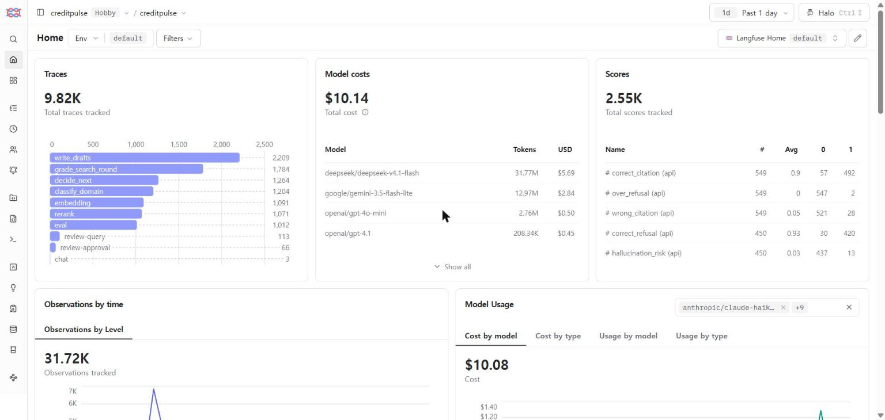

- 왼쪽: 지난 하루 9,820건. 역할 이름별로 초안 작성 `write_drafts` 2,209건, 검색 채점 `grade_search_round` 1,784건, Supervisor 판단 `decide_next` 1,264건, 주제 분류 `classify_domain` 1,204건, 평가 질문 `eval` 1,012건, 서비스 질문 `review-query` 113건 등입니다.
- 가운데: 모델별 비용. 하루 동안 $10.14를 썼고 deepseek-v4.1-flash(작성) $5.69, gemini-3.5-flash-lite(채점) $2.84, gpt-4o-mini(주제 분류·Supervisor) $0.50, gpt-4.1 $0.45입니다. 11/12에는 재검색·인젝션 실험으로 평가를 여러 번 돌려 평소보다 많습니다.
- 오른쪽: 트레이스에 붙은 평가 점수 2,550건. `correct_citation`(정답 근거) 549건 중 492건이 1, `wrong_citation`(오답 근거) 28건, `over_refusal`(과잉 거절) 2건, `correct_refusal`(올바른 거절) 450건 중 420건, `hallucination_risk`(환각 위험) 13건. 일부러 구성을 낮춘 실행(132번)과 말바꿈 질문(137~140번)의 점수가 섞여 있어 채택 구성의 점수보다 낮습니다.

**스크린샷 2. 트레이스 목록: 질문과 결과가 한 줄씩**

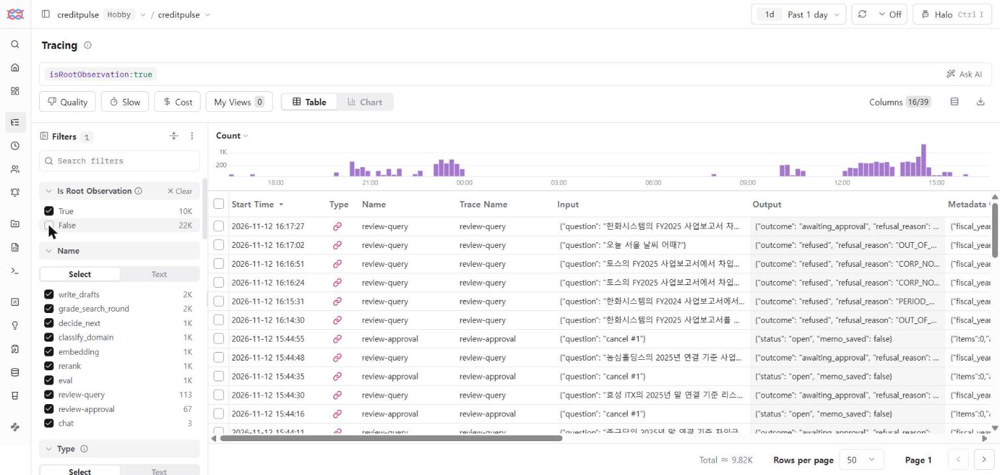

- 질문 단위(`isRootObservation:true`)로 거른 목록입니다. `review-query`는 배포 서비스에 들어온 질문 한 건, `review-approval`은 승인·취소 한 건입니다(11/12 재배포한 리비전 00046의 기록).
- 입력 칸에 질문, 출력 칸에 결과가 보입니다: `awaiting_approval`(승인 대기), `refused`와 사유(`OUT_OF_DOMAIN` 주제 밖, `CORP_NOT_IN_CORPUS` 코퍼스에 없는 회사, `PERIOD_…` 없는 기간).
- `cancel #1`은 배포 기준 측정 스크립트가 승인 대기를 남기지 않으려고 취소한 것입니다.

**스크린샷 3. 트레이스 상세: 질문 하나 안의 에이전트·노드·호출 계층과 평가 점수**


- 질문: "KG케미칼의 2025년 말 연결 기준 차입금(단기·장기, 사채 포함) 잔액 합계는 얼마인가요?" (v2 평가 62번 문항, 실행 이름 `w146_now_r1`, 11/13)
- 위쪽 띠: 이 질문에 **4.48초, $0.008, 66k 토큰**이 들었고(그래프 실행은 4.08초), 평가 점수 `correct_citation 1.00`, `wrong_citation 0.00`, `over_refusal 0.00`이 붙어 있습니다. 평가 점수가 트레이스에 연결돼 있다는 증거입니다.
- 왼쪽 나무: `supervisor` 아래에 `search_agent`와 `writer_agent`가 있고, 각 에이전트 아래에 노드와 그 노드가 부른 호출이 있습니다. 검색 에이전트(2.11초)에는 `retriever`(0.77초, 그 안의 `rerank` 0.42초·40,781토큰), `scorer`, `grader`(1.31초, 그 안의 `grade_search_round` $0.0027)가 있습니다. `classify_domain`(1.86초)은 입구의 주제 분류입니다. LLM 호출은 역할 이름으로 남습니다.
- 검색이 한 번뿐입니다(채점 뒤 재검색 끔, 140번).
- 오른쪽: 입력(질문)과 출력(결과 `answered`, 인용한 청크 id 3개).

**스크린샷 3-2. 같은 트레이스의 작성 에이전트: 쓰지 않은 초안은 `discarded`**

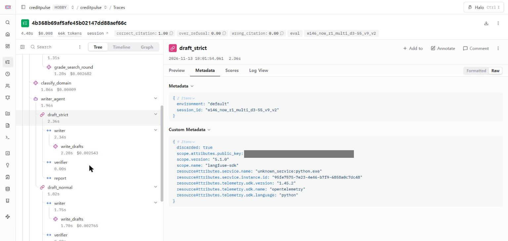

- 왼쪽 나무: `writer_agent`(1.96초) 아래에 초안 2개(`draft_strict` 엄격 지시 2.36초, `draft_normal` 보통 지시 1.82초)가 있고, 초안마다 `writer → verifier → report`가 한 번씩 돕니다. 작성 서브그래프를 2번 동시에 실행하기 때문입니다(112번).
- 오른쪽: 고르지 않은 `draft_strict`의 메타데이터에 `discarded: true`가 남아 있습니다. 보통 초안이 먼저 끝나 검증을 통과해 그것을 썼고, 엄격 초안은 기다리지 않았습니다(그래서 엄격 초안의 2.36초가 작성 에이전트의 1.96초보다 깁니다). 버린 호출도 지우지 않고 표시만 합니다. 회색 띠는 Langfuse 공개 키 값을 가린 것입니다.

**스크린샷 4. 같은 트레이스의 시간표: 호출이 겹쳐서 돈다**

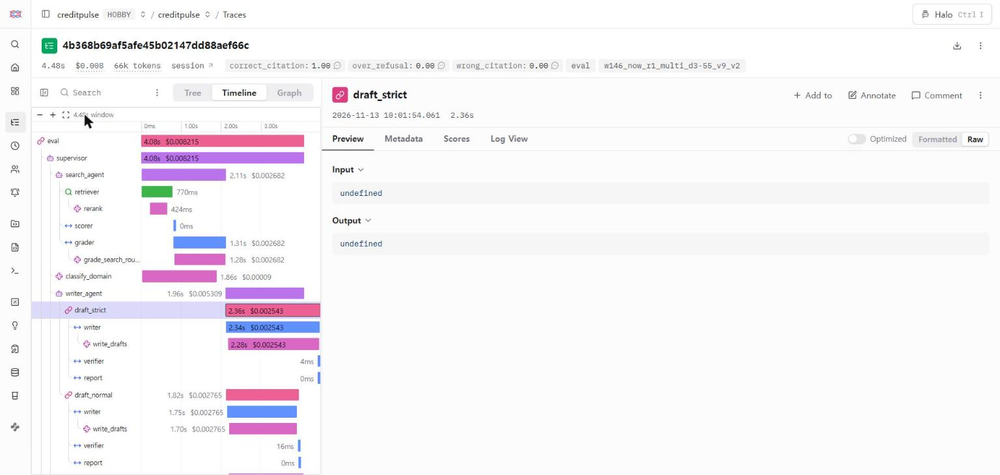

- 막대 하나가 관측 하나이고, 가로가 시간입니다(그래프 실행 4.08초). 왼쪽 이름의 들여쓰기가 계층입니다.
- **주제 분류(`classify_domain`, 1.86초)와 검색(`search_agent`, 2.11초)이 같은 시각에 시작해 겹쳐 돕니다.** 주제 분류를 기다리지 않고 검색을 미리 시작하기 때문입니다(110번).
- **초안 2개(`draft_strict`·`draft_normal`)가 채점(`grader`)이 끝난 직후 동시에 돕니다.** 채점이 고른 청크를 작성기 입력 앞에 두기 때문에 초안은 채점 뒤에 시작합니다(125번).
- 재검색 막대가 없습니다. 검색 2.11초 + 초안 약 2.0초가 전체 시간을 정합니다.

**스크린샷 5·5-2. 재검색을 켠 실행: 채점 → Supervisor 판단 → 두 번째 검색 (157번, 11/13)**

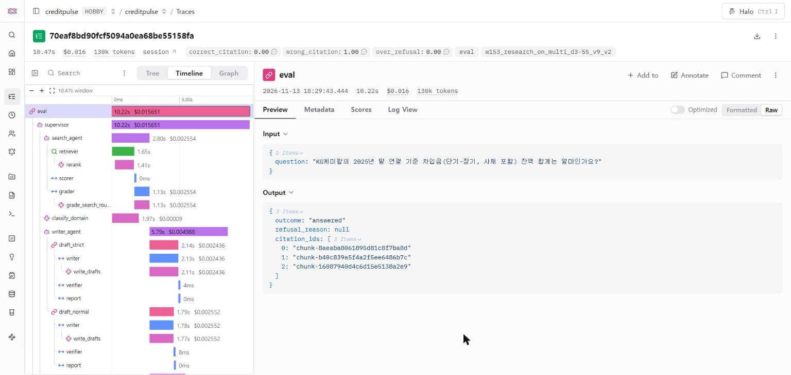

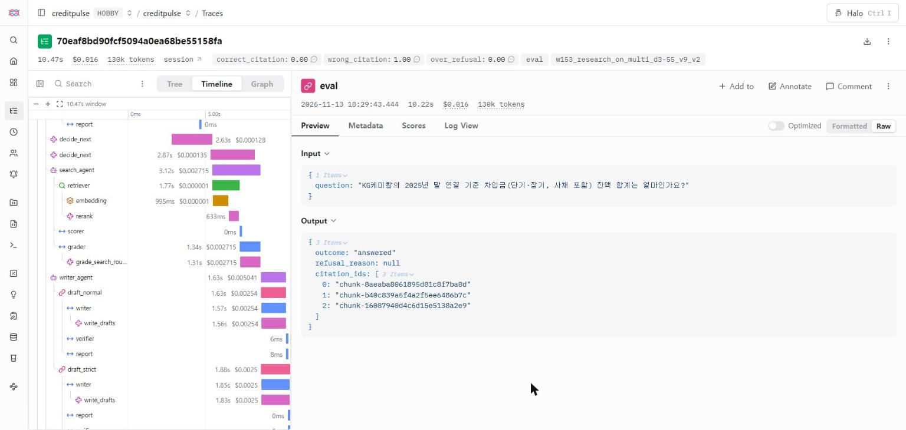

- 서비스 기본값은 재검색 끔입니다. 이 실행은 루프가 실제로 도는 것을 보이려고 재검색 허용 회차만 2로 바꿔 돌린 것입니다(v2 62번, 실행 이름 `w153_research_on`, 전체 10.2초·$0.016).
- 첫 장: 첫 `search_agent`(2.80초)의 채점이 끝나기 전에 초안 2개를 미리 씁니다. 둘째 장: `decide_next`(Supervisor 판단) 뒤에 두 번째 `search_agent`(3.12초)가 돌고, 그 아래 새 질의의 `embedding`·`rerank`·`grader`가 있으며, 이어서 초안을 다시 씁니다.
- 위쪽 점수가 `wrong_citation 1.00`입니다. 재검색 뒤 다른 절의 청크를 인용해 틀렸습니다(EVAL_REPORT 4-58).

**스크린샷 6. 배포된 서비스가 남긴 질문 트레이스 (11/13 12:58, 리비전 00051)**

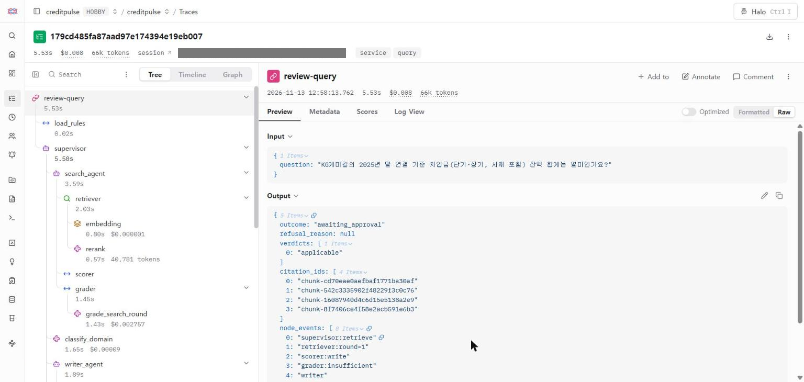

- 평가 러너가 아니라 Cloud Run의 서비스가 남긴 트레이스입니다(이름 `review-query`, 태그 `service`·`query`). 배포 주소 50건 측정(`svc_r6_direct`) 중 62번 질문입니다. 5.53초·$0.008·66k 토큰.
- 로컬 평가와 달리 `retriever` 아래에 질문 `embedding`(0.80초)이 있습니다. 서비스는 질문을 그때 임베딩합니다. 출력은 `awaiting_approval`과 인용 청크 4개입니다.
- 회색 띠는 사용자 id를 가린 것입니다.

**스크린샷 7. 지금 구성: 검색 → 채점 → Supervisor 판단 → 작성이 한 번씩 이어진다 (160번, 11/17)**

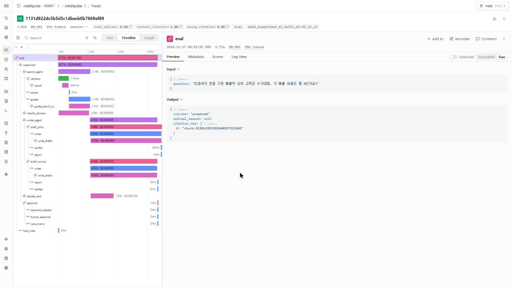

- v2 7번 문항(실행 이름 `w160_supervisor_r1`, 전체 6.73초·$0.001·59k 토큰. 3회를 동시에 돌린 실행이라 시간은 평소보다 깁니다).
- `search_agent`(2.16초: 검색 0.71초, 리랭크 0.44초, 채점 1.45초) 막대가 하나입니다. 재검색 코드를 지워 검색은 질문당 한 번입니다(159번).
- 채점 직후의 `decide_next`(1.55초)가 Supervisor LLM 호출입니다. 채점 보고를 읽고 작성과 거절 중 하나를 고릅니다(160번). 이 문항에서는 작성을 골랐습니다.
- `writer_agent`의 초안 2개는 그 판단을 기다리지 않고 채점이 끝나자마자 미리 쓰기 시작합니다. Supervisor가 거절을 고르면 그 초안은 버립니다.
- 스크린샷 3·4(11/13, `w146_now_r1`)는 재검색 코드를 지우기 전의 구성입니다. 그때도 검색은 한 번이었고, Supervisor LLM은 '재검색 대 작성'을 물었습니다.

**스크린샷 8. 답변 평가 점수(RAGAS)가 트레이스에 붙은 화면 (11/17)**

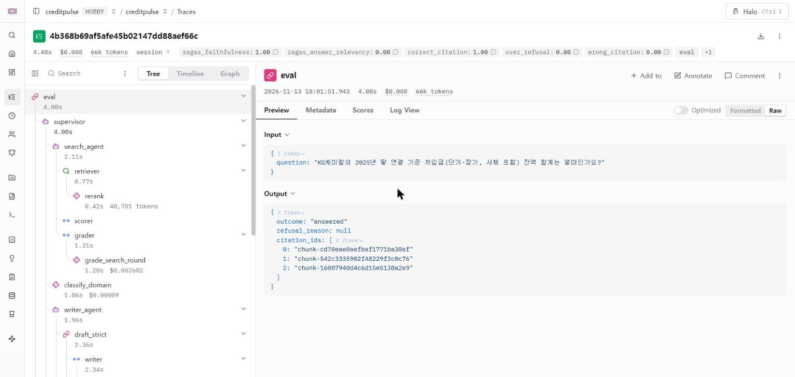

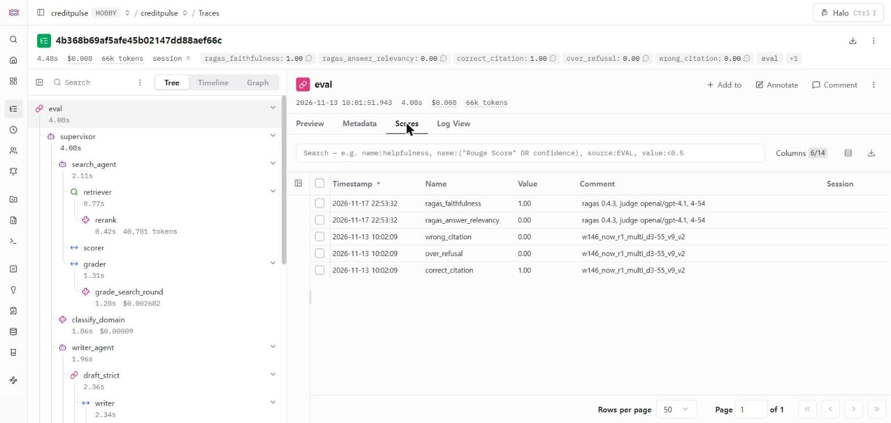

- v2 62번 문항의 평가 트레이스입니다(`4b368b69af5afe45b02147dd88aef66c`, 로컬 측정 `w146_now_r1`, 스크린샷 3과 같은 트레이스).
- 위 그림: 트레이스 머리의 점수 띠에 `ragas_faithfulness 1.00`, `ragas_answer_relevancy 0.00`이 응답 지표 3개(`correct_citation 1.00`, `over_refusal 0.00`, `wrong_citation 0.00`) 옆에 붙어 있습니다.
- 아래 그림: Scores 탭입니다. RAGAS 두 점수는 11/17 22:53에 붙였고 comment가 `ragas 0.4.3, judge openai/gpt-4.1, 4-54`입니다. 응답 지표 세 점수는 측정 때(11/13) 평가 러너가 붙인 것으로 comment가 회차 이름입니다.
- 답 관련성이 0.00인 것은 이 지표가 우리 답 형식(금액과 인용 위주의 짧은 판정)과 맞지 않아서이고, RAGAS를 잰 24문항 중 9문항이 0입니다. 채택·회귀 기준으로 쓰지 않는 참고 지표입니다(EVAL_REPORT 4-54).
- 붙이는 방법: `python -X utf8 scripts/attach_ragas_scores.py --apply`(RAGAS를 다시 재지 않고 저장된 점수를 옮김). 화면 왼쪽 아래의 계정 아이콘은 가렸습니다.

**관측으로 실제로 찾아낸 것**
- 11/7: 실행의 첫 문항만 느린 원인이 외부 API가 아니라 키워드 색인 준비였다는 것(EVAL_REPORT 7장) → 토큰표를 미리 계산해 최다 회사 첫 검색 13초 → 0.09초(11/9, 리눅스 컨테이너. 11/12 같은 조건 재측정은 16.8초 → 0.13초, 원시값 `evals/results/w99_bm25_first_search.service.linux.json`).
- 11/10: 작성기 출력이 초당 약 26토큰으로 느리다는 것(호출별 시간 ÷ 출력 토큰) → 처리량 우선 공급자로 초당 60~95토큰.
- 11/10: 주제 분류 호출 하나가 15초 걸린 문항(64번) → 늦은 호출 이중 요청.

---

## ② 비용과 응답 시간 (현재 코드로 단계별 실측)

대상: 채택 구성(121번, 코드 `ae7c432`)을 v2 50건에 같은 명령으로 3회. 검색까지 간 질문은 회당 29건, 합쳐서 87건입니다. 견줄 기준은 그 전 구성(115번, 코드 `27e0020`) 7회 203건입니다.

121번에서 더한 것은 세 가지입니다(11/11, `EVAL_REPORT.md` 4-34·4-35): 비교 질문의 회사별 검색을 동시에 실행, 첫 검색 점수가 임계값 미만이면 재검색 생략, 엄격 초안이 1초 넘게 먼저 끝나고 검증을 통과하면 보통 초안을 기다리지 않음.

### 응답 시간이 어떻게 변했나

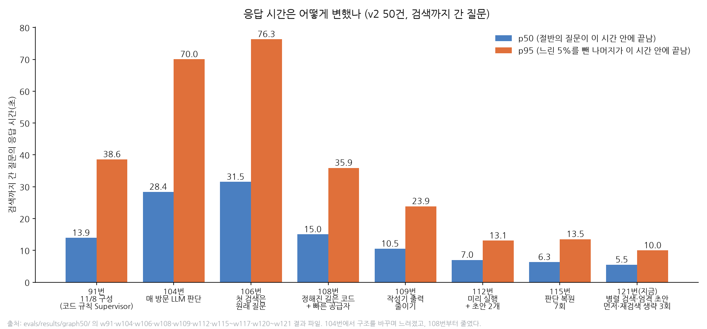

- 11/10에 Supervisor를 '매 방문 LLM 판단'으로 바꾸면서(104번) 두 배로 느려졌고, 그 뒤 일곱 단계로 줄였습니다.
- **지금: p50 5.5초, p95 10.0초**(3회 합산). 104번 구성(28.4초·70.0초)의 약 1/5~1/7이고, 바로 전 구성(6.3초·13.5초)보다 p50 0.8초·p95 3.5초 짧습니다.
- p95는 '정렬한 뒤 round(0.95 × (n − 1))번째 값'으로 셌습니다. 29건이면 두 번째로 느린 문항입니다. EVAL_REPORT 4-32의 104번 p95(61.9초)는 한 칸 낮은 순위로 센 값이라 이 그림의 70.0초와 다릅니다.

### 질문 하나는 어떤 순서로 처리되나

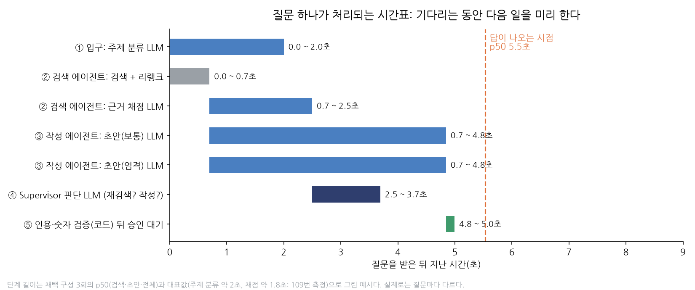

- 단계가 차례로 도는 것이 아니라 **겹쳐서** 돕니다. 그래서 단계별 시간을 더하면 전체 시간보다 큽니다.
- 가장 긴 것은 초안 쓰기(약 4초)입니다. 초안은 검색 청크가 나오자마자 시작하므로, 그 사이에 주제 분류·채점·Supervisor 판단이 끝납니다.

### 단계별 시간표 (검색까지 간 질문 87건, 채택 구성 3회)

| 단계 | p50 | p95 | 그 전 구성 7회(p50 · p95) | 무엇이 도나 |
|---|---|---|---|---|
| 리랭크(Voyage rerank-2.5, 후보 50개) | 0.54초 | 2.18초 | 0.59초 · 2.33초 | 리랭크 API |
| 검색 1회 전체(1차 검색 + 리랭크) | 0.70초 | 3.01초 | 0.83초 · 3.42초 | 주제 분류와 동시에 시작 |
| 검색 채점(gpt-4.1-mini) | 약 1.8초 | | | 109번 측정값. 미리 실행 뒤에는 따로 재지 못함 |
| 초안 1개(gpt-4o-mini) | 4.2초 | 7.8초 | 4.7초 · 9.0초 | 보통·엄격 2개를 동시에 |
| Supervisor 노드(주제 분류 LLM + 판단 LLM) | 3.2초 | 6.6초 | 4.1초 · 10.7초 | 이 동안 검색·채점·초안이 뒤에서 돈다 |
| 인용·숫자 검증, 승인 대기 | 0.01초 미만 | | | 코드 |
| **질문 전체** | **5.5초** | **10.0초** | 6.3초 · 13.5초 | 최대 15.4초, 평균 6.0초 |

- 두 구성의 값은 같은 방식으로 다시 계산했습니다(노드 시간 ÷ 호출 수, `node_ms` 파일). 이 문서의 이전 판에 있던 검색·초안 값(0.79초·5.0초 등)과 조금 다른 것은 계산 방식 차이입니다.
- 1차 검색(질의 임베딩 + 벡터·BM25 결합)만의 시간은 이번에 따로 나누지 않았습니다. 그 전 구성에서 p50 0.13초였습니다.
- 가장 크게 줄어든 것은 Supervisor 노드입니다. 엄격 초안을 먼저 쓰면 보통 초안을 기다리지 않고, 첫 검색 점수가 낮으면 재검색 판단 자체가 없기 때문입니다(Supervisor LLM 판단 29회 → 24회).

- 검색과 리랭크는 리랭크 호출 시간(`rerank_latency_ms`)을 검색 노드 시간에서 빼서 나눴습니다(11/10 점검 의견 ④).
- 위 표(`node_ms` 파일 기준)에서는 검색 채점만 따로 재지 못했습니다. 미리 실행한 서브에이전트의 노드 시간이 시작한 노드 아래로 기록되기 때문입니다. Langfuse 트레이스 상세에서는 `search_agent > grader` 관측으로 채점 시간을 따로 볼 수 있습니다(스크린샷 3).

### 여러 번 돌리면 얼마나 같은가

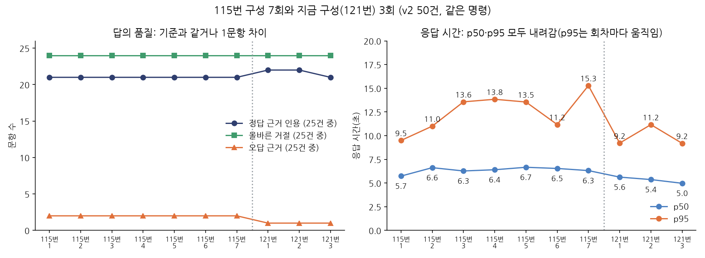

- **품질은 그 전 구성과 같거나 1문항 차이입니다**: 그 전 구성은 7회 모두 정답 근거 21/25·오답 근거 2/25였고, 채택 구성 3회는 정답 근거 22·22·21, 오답 근거 1·1·1입니다. 올바른 거절 24/25, 과잉 거절 0, 환각 위험 0은 10회 모두 같습니다.
- **p50은 5.0~5.6초, p95는 9.2·11.2·9.2초입니다**(그 전 구성 5.7~6.7초, 9.5~15.3초). 검색 문항이 29건이라 p95는 두 번째로 느린 문항이고, 호출 하나가 늦으면 2~4초 달라집니다. "p95 9.2초"가 아니라 "3회에 9~11초(합산 10.0초)"로 말하는 것이 정확합니다. 11.2초가 나온 회차는 그 전 구성의 범위 안에 있습니다.
- **가장 느린 문항은 줄지 않았습니다.** 1번(소송 건수, 두 초안이 모두 검증에 실패하는 문항)은 12.6~15.4초로 그대로입니다.
- 정답 근거 +1은 36번입니다. 엄격 초안이 청크를 더 많이 인용해(4개 → 6~10개) 정답 청크가 들어간 것이라, 답의 질이 좋아진 것으로만 읽으면 안 됩니다. 3회차의 21은 39번이 인용 없는 '확인 필요' 답으로 나온 경우입니다.

### 비용

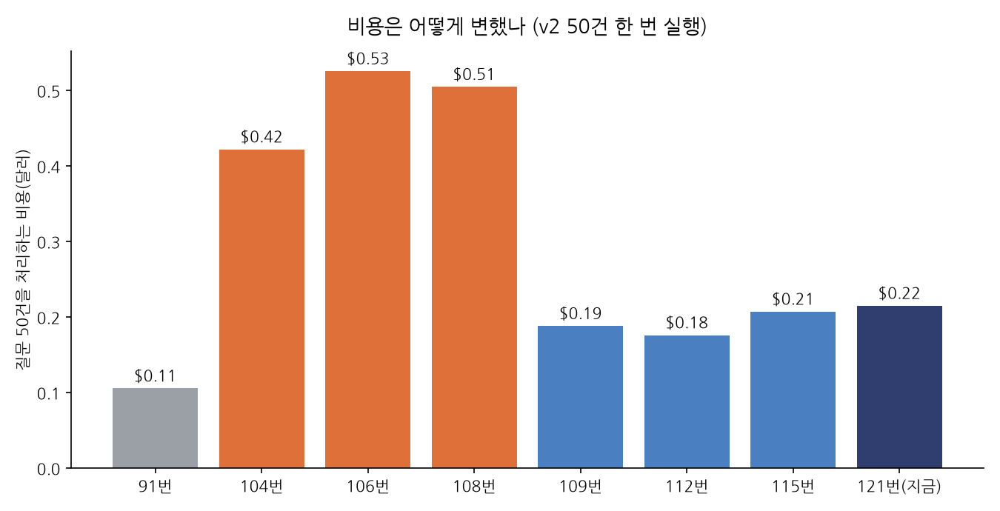

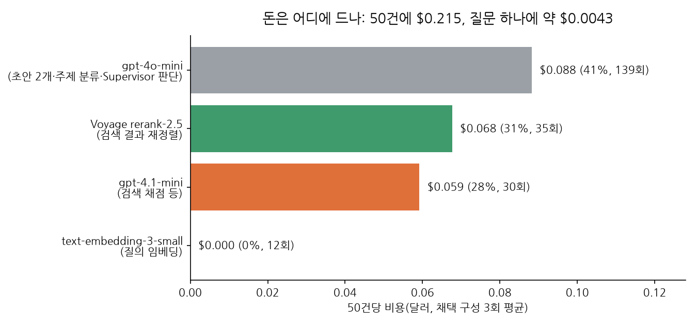

- **질문 50건에 평균 $0.215, 질문 하나에 약 $0.004**입니다(3회 $0.24·$0.24·$0.17. 그 전 구성 7회는 평균 $0.207).
- gpt-4o-mini가 41%입니다(50건에 139회: 초안 2개, 주제 분류, Supervisor 판단, 이중 요청). 리랭크가 31%, gpt-4.1-mini(검색 채점 등)가 28%입니다.
- 그 전 구성과 견주면 gpt-4o-mini(171 → 139회)와 리랭크(40 → 35회)는 줄었고, gpt-4.1-mini 비용이 $0.032 → $0.059로 늘었습니다. 늘어난 원인은 가르지 못했습니다(그 전 구성 측정 뒤 main에 들어온 다른 변경도 이 모델을 씁니다).
- 104번 구성($0.42)의 절반, 91번 구성($0.11)의 두 배입니다. 91번보다 비싼 이유는 검색 채점(없던 것), Supervisor 판단 LLM(없던 것), 초안 2개입니다.

---

## ③ 평가 회귀 시험 (pytest)

평가 점수가 기준에 못 미치면 실패하는 시험을 만들었습니다. 자세한 실행 기록은 [d8_eval_regression_2026-11-11.md](../evidence/d8_eval_regression_2026-11-11.md)에 있습니다.

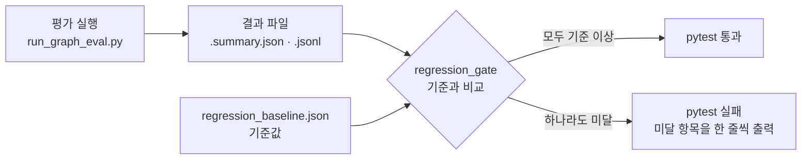

| 넣은 결과 | 시험 결과 | 출력 |
|---|---|---|
| 지금 채택 구성(`w121_new_r1`, 3회 중 p95가 가장 높은 회차) | 통과 | `4 passed` |
| 113번 그래프(환각 위험 1, 미채택) | **실패** | `hallucination_risk 1: 기준 0 이하` |
| 111번 그래프(정답 근거 19, 미채택) | **실패** | `correct_citation 19: 기준 20 이상` |
| 104번 그래프(느리고 비쌈) | **실패** | 검색 1회차 지표 4개, 비용 $0.523, p95 57.8초 |

- 기준: 정답 근거 20 이상, 오답 근거 3 이하, 올바른 거절 23 이상, 과잉 거절 0, 환각 0, 검색 1회차 지표 유지, p95 20초 이하, 비용 $0.35 이하.
- 실행: `python -m pytest tests/test_eval_regression.py`. 새로 잰 결과는 `EVAL_REGRESSION_SUMMARY`에 경로를 줍니다. 유료 API를 부르지 않습니다.
- CI(`.github/workflows/ci.yml`)에 단계로 넣었습니다. 지금은 조직 Actions 한도가 소진돼 로컬 실행 기록으로 대신합니다(전체 `950 passed, 8 skipped`).

---

## ④ 개선 2회차 실험 사전 등록

실패 유형 가운데 지금 가장 큰 것은 작성 단계입니다(검색은 23/23건 정답을 찾음). 정답 근거를 못 내는 4문항 중 고칠 수 있는 두 유형을 하나씩 따로 등록해 쟀습니다. 등록(기대·채택 기준)을 측정보다 먼저 커밋했습니다(`evals/PREREGISTER.md` 116·117번).

| # | 실패 유형 | 바꾼 것(하나) | 3회 합 결과 (기준 → 새 그래프) | 판정 |
|---|---|---|---|---|
| 116 | 작성기가 공시에 없는 숫자를 씀(1번: 소송 '몇 건') | 초안 2개가 모두 검증에 실패하면 더 큰 모델(gpt-4.1)로 구제 초안 | 정답 근거 63 → 65(1번이 3회 중 1회 통과), p95 평균 12.8 → 15.5초 | 미채택(p95 '기준 + 2초 이하'를 넘음) |
| 117 | 같은 숫자가 있는 다른 표를 인용(오답 근거, 52번) | 채점이 맞다고 본 청크를 작성기 입력 앞쪽에 | 정답 근거 63 → 66, 오답 근거 6 → 3(3회 모두 52번이 정답 근거로), p50 +1.9초·p95 평균 13.3 → 16.6초 | 미채택(p95 13초 이하를 넘음). 기본 꺼짐 옵션으로 남김 |

- 달라진 문항: 116번은 1번(확인 필요 → 답함, r1에서만), 117번은 52번(세 회차 모두 인용 청크가 바뀜).
- 그 뒤 120·121번(응답 시간 줄이기: 병렬 검색, 재검색 생략, 먼저 통과한 엄격 초안)도 측정 전에 등록했고, 같은 구성 3회가 모두 기준을 통과해 채택했습니다. 세 변경을 한 번에 넣은 것은 '한 번에 하나' 규칙의 예외라 등록 행에 그 사실과 판정 방법을 적었습니다(② 참고).
- 117번은 품질 차이가 세 회차 모두 같은 방향이었습니다. 속도 기준 때문에 기본값으로 켜지 않았고, `--grade-reorder`로 켤 수 있습니다. 속도와 품질 중 무엇을 택할지는 팀 결정으로 남깁니다.

---

## 한계와 남은 일

- **콜드 스타트**: 배포 주소의 첫 요청이 12초대입니다(11/10 점검). 이번에 줄인 것은 뜬 뒤의 응답 시간이고, 인스턴스가 뜨는 시간은 그대로입니다. Cloud Run 최소 인스턴스를 1로 두면 없어지지만 상시 비용이 듭니다(팀 결정 필요).
- **운영 배포**: 이번 구성은 아직 Cloud Run에 올리지 않았습니다. 올리기 전에 확인할 것: 처리량 우선 공급자 설정으로 질문·청크가 Azure로도 간다는 점, 질문당 비용 약 $0.004.
- **p95의 변동**: 문항이 29건뿐이라 회차마다 움직입니다(채택 구성 3회 9.2~11.2초, 그 전 구성 7회 9.5~15.3초). 채택 구성은 3회만 쟀습니다. 더 정확히 재려면 검색 문항이 많은 별도 질문 묶음이 필요합니다.
- **무엇이 줄였는지는 가르지 못합니다**: 121번의 세 변경을 함께 켜고 쟀고, 그 전 구성 7회는 예전 코드에서 잰 값입니다. 재검색 생략은 평가셋 안에서만 손해가 없음을 확인했습니다.
- **평가 회귀 시험의 범위**: 저장된 결과 파일을 검사합니다. PR마다 유료 평가를 자동으로 돌리지는 않습니다.

## 다시 만들기

```powershell
python -X utf8 scripts/make_d8_charts.py            # 이 문서의 도표 5장 (matplotlib 필요)
python -X utf8 docs/diagrams/agent_graph.py          # README의 에이전트 그래프 그림
python -m pytest tests/test_eval_regression.py -v    # 평가 회귀 시험
python -X utf8 -m evals.regression_gate              # 같은 검사를 명령줄로
```
